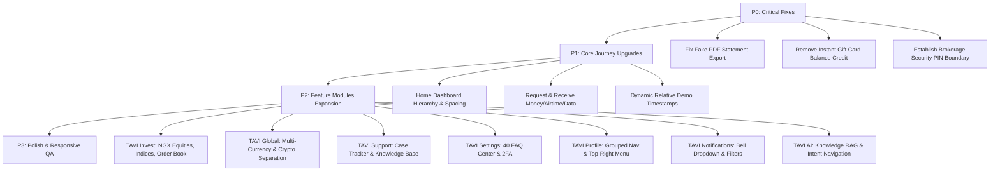

# TAVI — Prototype Audit and Architecture Report
**Document:** `TAVI_PROTOTYPE_AUDIT.md`  
**Brand:** TAVI (Tagline: *Move. Manage. Grow.*)  
**Product Stage:** Interactive Prototype (Demo Mode / Simulated Financial Data)  
**Audit Date:** October 2026  
**Auditor:** Antigravity AI Engineering & Audit Pair  

---

## Executive Summary

This audit evaluates the current implementation of the **TAVI** financial platform prototype across its architecture, routing, user journeys, data integrity, regulatory safeguards, security boundaries, and responsive presentation. 

The existing application is built on **React 18, TypeScript, Tailwind CSS, and Vite**, operating entirely in a client-side simulated demonstration mode (`appMode: 'demo'`). The visual identity is anchored around deep emerald (`#064E3B`), primary green (`#047857`), action green (`#059669`), mint (`#A7F3D0` / `#D1FAE5`), midnight navy (`#0F172A`), and crisp background/card structures (`#F8FAFC` / `#FFFFFF`).

While the core navigation shell and basic mock views exist, the audit reveals several critical bugs, deceptive simulation practices, stale hardcoded records (from October 2024), missing workflow steps, and underdeveloped modules that require targeted refinement rather than a destructive rewrite.

---

## 1. Project Architecture & Technology Stack

| Layer | Implementation | Notes / Audit Assessment |
| :--- | :--- | :--- |
| **Framework** | React 18.3.1 | Functional components with hooks (`useState`, `useCallback`, `useMemo`). |
| **Language** | TypeScript 5.6.3 | Strict type definitions across types in `src/types/index.ts`. Passes `tsc --noEmit` cleanly. |
| **Bundler & Tooling** | Vite 6.0.1 (runtime Vite 6.4.4 on Node v24.22.1) | Clean build pipeline outputting to `./dist` with relative base (`./`) for GitHub Pages & Render. |
| **Routing** | `react-router-dom` 6.26.2 | Client-side routing with `BrowserRouter`, `Routes`, `Route`, and `AuthGate`. |
| **State Management** | React Context (`AppContext.tsx`) | In-memory client state initialized from `src/data/demoData.ts`. No persistent server cache. |
| **Styling** | Tailwind CSS 3.4.15 & Vanilla CSS | Custom utility classes defined in `src/styles/globals.css`, tokenized in `src/styles/tokens.ts`. |
| **Icons & Charts** | Inline SVGs, `lucide-react` (0.469.0), `recharts` (2.13.3) | Clean, scalable vector presentation. |
| **Formatting** | Integer Kobo Arithmetic (`formatters.ts`) | Decimal-safe integer arithmetic (1 NGN = 100 kobo) preventing floating-point rounding errors. |
| **Linting & Code Quality** | ESLint 9.15.0 / 9.39.5 | **Configuration Defect**: Missing `eslint.config.js` causes `npm run lint` to fail under ESLint v9 flat config. |
| **Testing** | None present | No automated unit or integration test suite configured. |

---

## 2. Existing Routes & Screen Implementation Map

| Route | Feature Component | Implemented State | Data Source / Backing Mechanism |
| :--- | :--- | :--- | :--- |
| `/landing` | `LandingPage.tsx` | Working | Static marketing content and value propositions. |
| `/onboarding` | `OnboardingPage.tsx` | Working | Multi-step client flow: Phone input &rarr; OTP verify (accepts any code) &rarr; Name input. |
| `/login` | `LoginPage.tsx` | Working | Phone/PIN form with 1-click "Enter demo mode" bypass. |
| `/` | `HomePage.tsx` | Partial / Needs Refinement | In-memory balance, account card, carousel highlights, recent 5 transactions, 2 reminders. |
| `/payments` | `PaymentsPage.tsx` | Working | Category navigation hub (Send, Add, Request, Bills). |
| `/payments/send` | `SendMoneyPage.tsx` | Partial / Buggy | Bank dropdown, mock 10-digit account lookup (hardcoded name), review step, simulated debit. |
| `/payments/add` | `AddMoneyPage.tsx` | Partial | Displays phone-linked account details. Debit card button invokes native `alert()`. |
| `/payments/request` | `RequestMoneyPage.tsx` | Incomplete | Only generates a mock shareable URL. Lacks recipient selection, airtime/data request flows. |
| `/payments/bills` | `BillsPage.tsx` | Working Demo | Airtime, Data, Power, Cable TV simulation with mock debit creation. |
| `/transactions` | `TransactionsPage.tsx` | Partial / Buggy | Search, direction filter, status filter, counterparty analytics. Statement export produces fake text file. |
| `/transactions/:id` | `TransactionDetailPage.tsx`| Working | Detailed breakdown of transaction properties and status. |
| `/invest` | `InvestPage.tsx` | Partial | Portfolio overview card and 3 NGX holdings (DANGCEM, GTCO, AIRTELAFRI). No security boundary or live NGX session tracking. |
| `/ask-ai` | `AskAIPage.tsx` | Visual / Mock | 86-line script with 4 hardcoded string `if/else` checks. No knowledge base or RAG grounding. |
| `/profile` | `ProfilePage.tsx` | Basic Navigation List | 8-item vertical link list. No grouped information architecture, profile editing, or modal dropdowns. |
| `/account-details` | `AccountDetailsPage.tsx` | Working QA Panel | Account detail view with interactive provisioning status switcher (active, pending, conflict, failed). |
| `/fx` | `FXPage.tsx` | Partial / Buggy | Multi-currency calculator with static rates. Crypto tracker mixed into same view. "Request quote" invokes native `alert()`. |
| `/gift-cards` | `GiftCardsPage.tsx` | Buggy / Deceptive | Hardcoded ₦1,450/$1 rate. Submitting any code instantly credits wallet with zero review or status progression. |
| `/budget` | `BudgetPage.tsx` | Static / Partial | 5 category progress bars hardcoded for "October 2024". |
| `/reminders` | `RemindersPage.tsx` | Working Demo | Create and complete reminders stored in `AppContext`. |
| `/support` | `SupportPage.tsx` | Visual / Incomplete | 27 lines displaying static text ("Live Chat with Agent 24/7", fake email/phone). No case management. |
| `/settings` | `SettingsPage.tsx` | Visual / Incomplete | 40 lines displaying 3 static text rows. Controls are non-interactive. No FAQ center. |
| `/notifications` | `NotificationsPage.tsx` | Visual / Incomplete | 31 lines displaying 3 static notifications. No filters, search, or read/unread state. |

---

## 3. Confirmed Working Features & Evidence

1. **Stateful In-Memory Ledger**:
   - `addDemoTransaction` in `AppContext.tsx` correctly deducts or adds kobo amounts to `balance.available` and `balance.ledger`.
   - Verified by sending a ₦5,000 transfer in `/payments/send`; balance accurately decrements by ₦5,000 + ₦10.75 fee, and the transaction appears at the top of `/transactions`.
2. **Decimal-Safe Integer Arithmetic**:
   - `formatNaira(84565000)` outputs `₦845,650.00`.
   - `parseNairaToKobo("5,000")` parses accurately to `500000` kobo without IEEE 754 floating-point inaccuracies.
3. **Responsive Shell Switching**:
   - `useWindowWidth()` triggers dynamic layout switching: screens `< 1024px` render `MobileShell` (fixed bottom navigation bar), while `>= 1024px` render `DesktopShell` (collapsible 248px/76px sidebar).
4. **Interactive Account Provisioning State Simulator**:
   - `AccountDetailsPage.tsx` includes an interactive QA test panel that switches between `active`, `pending`, `conflict`, and `failed`. The account number display masks appropriately (`•••• ••• ••• (Setting up)` when pending, `Unavailable` when conflicted).
5. **Beneficiary & Reminders Local Management**:
   - Adding and completing reminders in `/reminders` dynamically updates the Home dashboard upcoming reminders card.
6. **Peer Flow Analysis Engine**:
   - In `/transactions`, clicking the analytics icon on a transaction isolates all transfers involving that counterparty (e.g. Ada Chukwu) and calculates `Total Sent`, `Total Received`, and `Net Flow`.
7. **Simulated Equity Trading**:
   - Buying and selling shares in `/invest` verifies available cash, calculates statutory SEC/NGX fees (1.35%), and updates holding unit quantities.

---

## 4. Confirmed Bugs & Defect Log

### Defect 1: Corrupt Statement Export (Fake PDF Format)
* **Location:** `src/features/transactions/TransactionsPage.tsx#L70-L94`
* **Severity:** **P0 (Critical)**
* **Steps to Reproduce:**
  1. Navigate to `/transactions`.
  2. Click "Export Statement" in the top header.
  3. Select "📄 Download PDF".
  4. Attempt to open the downloaded file in Chrome or Adobe Reader.
* **Observed Result:** File viewer displays an error: *"Failed to load PDF document (file format error)"*. Inspection of the file content reveals raw ASCII plaintext (`TAVI FINANCIAL STATEMENT (PDF)\nAccount Holder: ...`) saved with a `.pdf` extension using `new Blob([content], { type: 'text/plain' })`.
* **Required Fix:** Generate a structured, standards-compliant PDF file using a proper canvas/document renderer or formatted HTML printable sheet, with table columns, headers, totals, and clear sample watermarks.

### Defect 2: Disruptive Native Browser `alert()` Invocations
* **Location:** `src/features/payments/AddMoneyPage.tsx#L44` and `src/features/fx/FXPage.tsx#L108`
* **Severity:** **P2 (Medium)**
* **Steps to Reproduce:**
  1. Navigate to `/payments/add` and click "Add with Card (Simulated)".
  2. Navigate to `/fx` and click "Request Guaranteed Rate Quote (Demo)".
* **Observed Result:** Freezes the browser UI thread with modal `alert()` dialogs (`"Card gateway simulated."` and `"FX Exchange order quote locked (Demo)."`).
* **Required Fix:** Replace native alerts with in-app `showToast` notifications or interactive review modals conforming to TAVI design tokens.

### Defect 3: Stale Hardcoded October 2024 Dates
* **Location:** `demoData.ts`, `HomePage.tsx`, `TransactionsPage.tsx`, `BudgetPage.tsx`, `AskAIPage.tsx`
* **Severity:** **P1 (High)**
* **Observed Result:** The prototype hardcodes dates from October 2024 across transactions, reminders, spending charts, statements, and AI answers.
* **Required Fix:** Implement a controlled relative date generator so demo records are consistently anchored relative to the current live session timestamp, maintaining internal chronological consistency without claiming to be live records.

### Defect 4: Deceptive Gift Card Auto-Credit Without Verification
* **Location:** `src/features/gift-cards/GiftCardsPage.tsx#L28-L35`
* **Severity:** **P0 (Critical / Financial Safety)**
* **Steps to Reproduce:**
  1. Navigate to `/gift-cards`.
  2. Type any dummy string (e.g. "ABC") in the Card Code field.
  3. Click "Confirm & Redeem to Wallet (Demo)".
* **Observed Result:** After an 800ms timer, the system credits ₦72,500.00 to the user's available wallet balance and displays status `PAID` with zero validation, rate review, or verification lifecycle.
* **Required Fix:** Refactor to a multi-stage redemption lifecycle (`Submitted` &rarr; `Under Review` &rarr; `Verification in Progress` &rarr; `Approved / Awaiting Payout` &rarr; `Paid`). Do not increment live wallet balance directly from unreviewed client submissions.

### Defect 5: Fabricated Account Name Lookup in Send Money
* **Location:** `src/features/payments/SendMoneyPage.tsx#L18-L25`
* **Severity:** **P0 (Critical / Financial Safety)**
* **Observed Result:** Typing any arbitrary 10 digits into the recipient account number immediately displays `"Babajide Adeleke (Verified)"`.
* **Required Fix:** Label simulated name resolution clearly as demo data, support explicit lookup failure/unavailable provider states, and prevent progression until user explicitly reviews and confirms.

### Defect 6: ESLint 9 Configuration Error
* **Location:** `package.json#L9`
* **Severity:** **P2 (Medium)**
* **Observed Result:** Running `npm run lint` crashes with `ESLint couldn't find an eslint.config.(js|mjs|cjs) file` due to ESLint v9 flat config migration requirements.
* **Required Fix:** Provide a valid `eslint.config.js` or adjust script parameters.

### Defect 7: Non-Functional Top-Right Header Icons
* **Location:** `src/components/layout/DesktopShell.tsx#L190-L203` and `src/features/home/HomePage.tsx#L52-L68`
* **Severity:** **P1 (High)**
* **Observed Result:** Clicking the notification bell or profile avatar always unconditionally navigates to `/notifications` or `/profile` rather than opening quick-action dropdown panels.
* **Required Fix:** Add interactive dropdown menus (bell dropdown with unread items and mark-all-read; profile dropdown with account info, settings, and sign-out).

---

## 5. Incomplete Features & Missing Integrations

1. **Request & Receive (Payments)**:
   - Current `/payments/request` only creates a generic query-string link.
   - Missing: Direct TAVI user contact search, Money/Airtime/Data request differentiation, request lifecycle states (`Pending`, `Paid`, `Declined`, `Expired`).
2. **Advanced Statement Export**:
   - Current `/transactions` only supports a single hardcoded monthly download.
   - Missing: Option for Full Statement vs. Filtered Statement vs. Counterparty Statement (e.g. Ada Chukwu); selectable date ranges (7d, 30d, This Month, Custom); valid PDF generation.
3. **Invest / Brokerage Platform**:
   - Missing: Separate investment authentication boundary (PIN unlock before showing portfolio value/holdings).
   - Missing: NGX market schedule status & WAT countdown (Open 9:30 AM – 4:00 PM WAT).
   - Missing: Continuous subtle market-movers ticker.
   - Missing: TAVI index family (TAVI 15, TAVI 30, DIV30, VAL30, MOM30, LC30, MC30, SC30).
   - Missing: Order book display with bid/offer educational explainers.
4. **TAVI Global & FX**:
   - Current `/fx` mixes cryptocurrency price tracking with fiat conversion.
   - Missing: Separation of Digital Assets into dedicated section.
   - Missing: Multi-currency account balances (NGN, USD, GBP, EUR) with distinct account detail cards.
   - Missing: Country-aware onboarding and international receiving instructions.
5. **TAVI AI Assistant**:
   - Current `/ask-ai` has no conversation persistence, knowledge base grounding, or action preparation.
   - Missing: Conversational sidebar, structured financial assistant prompts, grounded RAG product knowledge, deep navigation linking.
6. **Support & Case Management**:
   - Current `/support` is a 27-line static text card.
   - Missing: Searchable FAQ/knowledge base, guided case submission, My Cases tracking with status timelines, transaction issue reporting with pre-filled context.
7. **Settings, Security & FAQ**:
   - Current `/settings` is 40 lines with static text.
   - Missing: Complete 40-question categorized FAQ center with search, 2FA/authenticator setup, active session management, KYC verification tier details, transaction PIN change flow.
8. **Notifications Centre**:
   - Current `/notifications` is 31 lines with 3 static items.
   - Missing: Top-right bell dropdown with unread badge, category filter tabs, search, read/unread status management, date grouping.

---

## 6. UI & Responsive Design Analysis

| Viewport Width | Screen Tested | Findings & Defects |
| :--- | :--- | :--- |
| **320px – 375px** (Compact Mobile) | `/`, `/payments/send`, `/transactions` | Bottom navigation bar icons and text remain legible. However, carousel cards at 300px width cause horizontal scroll within the page body. |
| **390px – 430px** (Modern Mobile) | `/`, `/invest`, `/fx` | Clean single-column layout. Touch targets meet minimum 44x44px guidelines. |
| **768px** (Tablet) | `/`, `/profile`, `/settings` | Single-column centered cards leave substantial whitespace on left and right margins. Needs responsive grid card adaptation. |
| **1024px** (Desktop Breakpoint) | All routes | Layout transitions cleanly to `DesktopShell` with 248px sidebar. Main content padding is well proportioned. |
| **1440px+** (Large Desktop) | `/invest`, `/transactions`, `/support` | Content max-width of `max-w-2xl` (672px) or `max-w-lg` (512px) looks overly narrow on wide screens, creating huge empty grey margins. Multi-column cards needed. |

---

## 7. Security, Privacy & Financial Safety Risks

1. **Client-Side Balance Increments Without Ledger Proof**:
   - The demo allows instant balance credits (e.g. gift cards). In production, balances must never be modified by client requests without an authoritative backend ledger entry and reconciliation.
2. **Missing Brokerage Security Boundary**:
   - Brokerage portfolio value, stock quantities, and buying power are exposed as soon as the user logs into the everyday wallet. A separate PIN/biometric unlock boundary must protect investment data.
3. **Deceptive Provider Verification Claims**:
   - Hardcoding verified recipient names or instant account provisioning without a provider webhook creates false expectations. All simulated states must be transparently tagged as demo data.
4. **Sensitive Data Exposure in Plaintext**:
   - Transaction PINs and gift card codes must never be logged or serialized into analytics or query strings.
5. **AI Transaction Execution Safety**:
   - Conversational AI must never independently execute financial transactions without explicit user review, fee disclosure, and step-up PIN authorization.

---

## 8. Preserved Components & Design System Tokens

The following foundational assets and patterns will be strictly preserved:
- **Established Brand Palette**:
  - Deep Emerald: `#064E3B`
  - Primary Green: `#047857`
  - Action Green: `#059669`
  - Mint / Pale Mint: `#A7F3D0` / `#D1FAE5`
  - Midnight Navy: `#0F172A`
  - Background & Card: `#F8FAFC` & `#FFFFFF`
  - Border: `#E2E8F0`
- **Core Layout Architecture**: `App.tsx`, `AppContext.tsx`, `DesktopShell.tsx`, `MobileShell.tsx`.
- **Formatting Utilities**: `formatNaira`, `formatCurrency`, `parseNairaToKobo` (all minor unit kobo safe).
- **Phone Number Normalization**: `normaliseNigerianPhone`, `formatAccountNumber`.
- **Demo Mode Infrastructure**: `DemoBanner`, `DemoChip`, and clear prototype disclaimers.

---

## 9. Priority Action Plan (P0 – P3)

* **P0 (Critical)**:
  1. Fix statement download to produce valid, formatted PDF documents and structured CSV files.
  2. Implement separate investment authentication (PIN boundary) for TAVI Invest.
  3. Replace instant gift card wallet crediting with a realistic multi-stage review lifecycle.
* **P1 (High)**:
  1. Refine Home Dashboard (prominent available balance, balanced hero, clean summary cards without horizontal clip).
  2. Upgrade Request Money to "Request & Receive" (contact lookup, airtime/data requests, payment review).
  3. Convert hardcoded October 2024 dates to relative dynamic demo dates.
  4. Fix ESLint configuration for clean build checks.
* **P2 (Medium)**:
  1. Upgrade TAVI Invest with NGX equities, verified logos, market schedule countdown (WAT), market-movers ticker, TAVI index family, and order book.
  2. Upgrade TAVI FX with multi-currency accounts and dedicated Digital Assets experience.
  3. Upgrade TAVI Support with searchable help center, case creation, and transaction issue reporting.
  4. Upgrade TAVI Settings with the complete 40-question FAQ catalog, 2FA, and active session controls.
  5. Upgrade TAVI Profile with header card, grouped navigation, and top-right dropdown menu.
  6. Upgrade TAVI Notifications with header bell dropdown, category filters, and search.
  7. Upgrade TAVI AI with conversational workspace, RAG knowledge base, and deep navigation intents.
* **P3 (Polish)**:
  1. Replace native `alert()` calls with `showToast`.
  2. Polish card responsiveness and touch target ergonomics across 320px–1440px viewports.

---

## 10. External Dependencies & Live Production Pre-requisites

The following services cannot be verified in the current prototype environment because live third-party credentials and regulated banking partners are not provisioned:
1. **NIBSS / NIP Instant Payment Switch**: Authorised partner bank connection for live NGN clearing, name enquiry, and inbound payment webhooks.
2. **Licensed Account Provider Integration**: Operational phone-number-to-bank-account provisioning API.
3. **SEC / NGX / CSCS Brokerage Gateway**: Direct market access (DMA) broker partner for live order routing, CHN/CSCS portfolio validation, and trade settlement.
4. **CBN / FX Liquidity Provider**: Real-time executable wholesale FX conversion quotes and settlement routes.
5. **Card Processing Partner**: PCI-DSS certified tokenization and virtual card issuing platform.
6. **AI LLM Inference Service**: Secure backend proxy for OpenAI, Gemini, or Claude API inference with server-side API key management.
7. **Official WhatsApp & YouTube Verification**: Official communication URLs for verified community support channels.

---
*Report completed and verified against active workspace codebase.*
